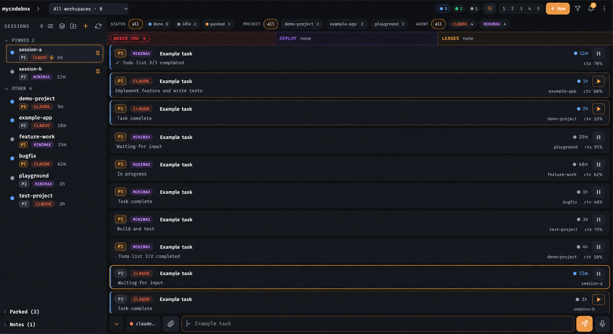
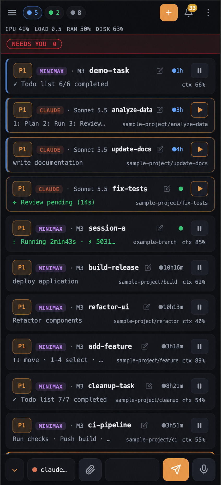
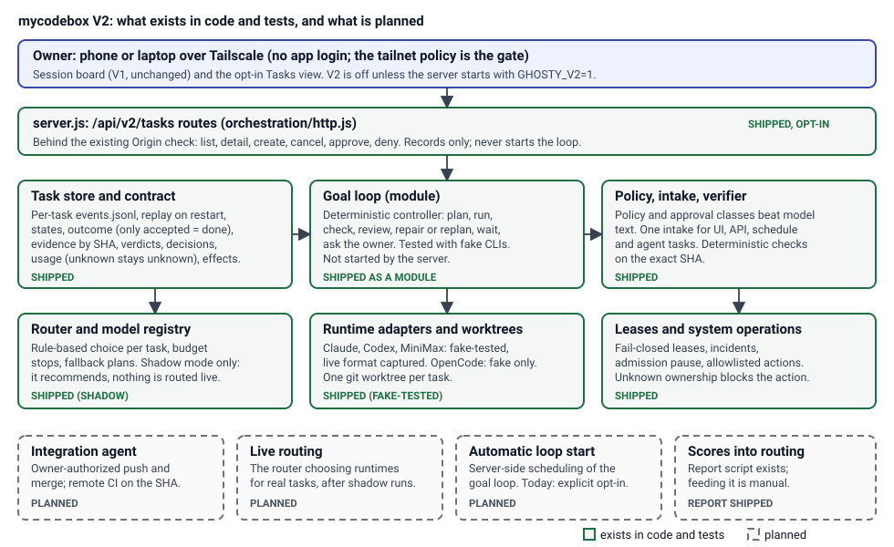
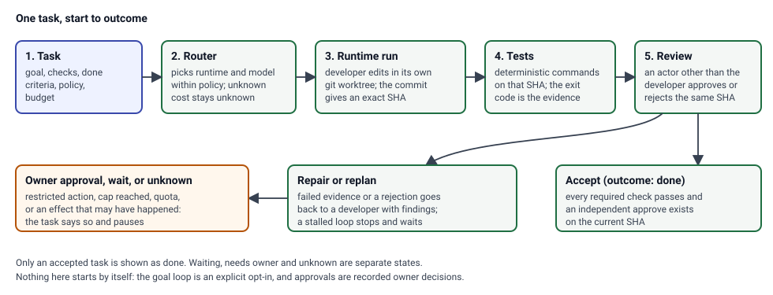

# mycodebox

<div align="center">
  <h3><b>Run a dozen AI coding agents from your phone.</b></h3>
  <p>See which one needs you, answer in one tap, keep an eye on cost. Self-hosted, over your own private network.</p>
  <p>
    <a href="#quick-start"><b>Quick start</b></a> •
    <a href="#screenshots"><b>Screenshots</b></a> •
    <a href="#features"><b>Features</b></a> •
    <a href="#current-capabilities--v2-roadmap"><b>V2 roadmap</b></a> •
    <a href="docs/INSTALL.md"><b>Install (with an AI agent)</b></a> •
    <a href="docs/REFERENCE.md"><b>Reference</b></a>
  </p>
</div>

---

## What it is

If you run several coding agents at once (Claude Code, Codex, MiniMax), each in its own terminal on one machine, you
spend your day walking between windows to find the one that stopped and is waiting for you. mycodebox puts them all
on one screen, on your phone or your laptop.

Every agent session is a card that says what it is doing: working, waiting for you, or done. Tap a card to read its
last answer, type a reply, or send a quick key like yes or continue. It installs on your phone like an app and can
notify you when an agent needs you, even when the app is closed.

It runs on your own machine and is intended for private access through [Tailscale](https://tailscale.com).
Configure the listener and tailnet policy using the install guide. Optional notifications, AI review and evaluation
can send data to configured providers; agent CLIs also use their own services.

---

## Screenshots

Desktop dashboard with sample session data:



Mobile dashboard with sample session data:



---

## Features

<table>
  <tr>
    <td width="50%" valign="top">
      <b>One board for every agent.</b><br>
      All your sessions at a glance, sorted by who needs you most. Switch to a grid or a single card, filter by project
      or agent, and pin the ones you care about.
    </td>
    <td width="50%" valign="top">
      <b>Answer from your phone.</b><br>
      Read the last reply as plain text, reply by typing, speaking or sending a quick key. Attach a screenshot by
      pasting, dropping or picking it.
    </td>
  </tr>
  <tr>
    <td width="50%" valign="top">
      <b>Get told when you are needed.</b><br>
      A "needs you" strip and phone notifications when an agent asks a question or stops, so work never sits still for
      hours.
    </td>
    <td width="50%" valign="top">
      <b>Priorities and pause.</b><br>
      Mark sessions P0, P1 or P2, pause one with a tap, and park sessions you are not using to free memory.
    </td>
  </tr>
  <tr>
    <td width="50%" valign="top">
      <b>Know what it costs.</b><br>
      Tokens and cost per session, project and day, plus how much of each plan's usage window you have used, so one
      runaway agent does not eat your week.
    </td>
    <td width="50%" valign="top">
      <b>An optional AI manager.</b><br>
      Sorts every stop into "safe to continue" or "needs a human", and can answer the safe ones after a countdown you
      can cancel. It is off by default and never answers about deploys, deletes, money or credentials.
    </td>
  </tr>
</table>

More, such as deploy coordination, usage reports and the session reporter plugin, is in the
[reference](docs/REFERENCE.md).

---

## Current capabilities / V2 roadmap

The session board above is what mycodebox does today. V2 adds a task engine next to it: a goal, deterministic checks,
an independent review and an honest outcome. **V2 is off by default** and part of it is not built yet. This section
separates what has code and tests from what is planned. Evidence is in [V2_VERIFICATION.md](V2_VERIFICATION.md);
nothing here is a claim about a live deployment.



How one V2 task is meant to run:



### What exists in code and tests, and what does not

| Area | Status | What that means |
|---|---|---|
| Session board, replies, manager, usage | Shipped (V1) | Unchanged. |
| Task store and contract (`orchestration/`) | In code and tests | Durable per-task logs, crash recovery, strict states. Only `accepted` is shown as done; waiting, needs owner and unknown are separate. |
| Policy, intake, deterministic verifier | In code and tests | Project policy and approval classes win over model text. One intake path for UI, API, schedule and agent tasks. |
| Goal loop | Wired into the server behind `GHOSTY_V2=1` (off by default) | One controller per state dir (lease), recovery at start; tasks run in worktrees of allowlisted repositories. Benchmarked through the HTTP API with real runtimes (see [scoring](docs/v2/SCORING.md)). |
| Router and model registry | In code and tests, shadow only | It recommends; nothing is routed live. Prices marked `PLACEHOLDER` are unknown, never $0. |
| Runtime adapters and worktrees | In code and tests with fake CLIs | Live output formats captured once per runtime (see the matrix). |
| Lease authority, incidents, admission pause (System Operations) | Wired with `GHOSTY_V2=1`: read-only telemetry/incidents, request-only actions | Fail-closed: unknown ownership blocks. Nothing destructive runs. |
| Integration (task branch push, merge approval) | Wired with `GHOSTY_V2=1` | Pushes only the task's own `v2/task/<id>` branch, and only when `GHOSTY_V2_PUSH_REMOTE` is set. Merges stay an SHA-bound owner approval; the server never merges or deploys. The full queue/CI-gate controller stays a module. |
| `/api/v2/tasks` routes and the **V2 tasks** view | In code and tests; browser-checked on synthetic data | Needs `GHOSTY_V2=1`. See [V2 task board](docs/USAGE.md#v2-task-board-opt-in). |
| Scoring report (`scripts/v2-score.js`) | In code and tests | Read-only. Feeding it to the router is manual. See [scoring](docs/v2/SCORING.md). |
| End-to-end acceptance T01 to T40, GL01 to GL14 | 54 of 54 rows PASS (`scripts/v2-acceptance.js`) | Deterministic E2E on fake runtimes and real git; see [acceptance matrix](docs/v2/ACCEPTANCE.md). One live smoke per installed runtime (OpenCode not installed). |
| Live routing for the manager, server-side merge/deploy | **Planned** | Not available. The V2 loop routes its own tasks; the manager's router stays shadow. |
| Tasks view gaps | **Deferred** | No graphical task graph (parent and children are listed), no per-run logs or live streaming, no editing of a task after creation, no retry-history timeline beyond the state history and runs list. |

### Safety model

- No login. The tailnet policy is the only gate for who can reach the server. Never expose it publicly. The listener
  defaults to loopback; set `HOST` explicitly for Tailscale access ([install](docs/INSTALL.md)).
- V2 routes sit behind the same Origin and JSON checks as every other write route. They are absent (404) unless
  `GHOSTY_V2=1`.
- Owner's chosen default (2026-10-11): dashboard sessions, resumes and the manager start with agent permission prompts skipped
  and folder trust pre-accepted; `AGENT_CMD_*` overrides win. V2 workers keep their own launch modes. Restricted actions (merge to a protected branch,
  deploy, credentials, destructive, host maintenance, money, customer) always need an explicit owner approval that names
  the request. Silence, or a model's recommendation, is never approval.
- Provider egress: Claude, Codex and MiniMax send prompts to their own services. mycodebox does not add providers on
  its own, and the optional manager, reviewer and evaluation features send data only when configured.
- The task state lives in `$GHOSTY_STATE_DIR/v2`, apart from the V1 state.

### Use cases

| You want to | Today | With V2 (opt-in) |
|---|---|---|
| See which agent needs you | Session board | Same board |
| Answer an agent from your phone | Card, reply, quick keys | Same |
| Track what an agent was asked and whether it was verified | Not available | Tasks view: goal, evidence on an exact SHA, verdicts, decisions |
| Approve a restricted action once, on purpose | Not available | Approve or deny a named request in the Tasks view |
| Compare models by verified completions and cost | Usage tab (cost and tokens) | `node scripts/v2-score.js` over the task store |

### Feature matrix by runtime

| Runtime | Adapter in code | Fake-CLI tests | Live output format captured | Live task run |
|---|---|---|---|---|
| Claude Code | Yes | Yes | Yes ([formats](docs/v2/RUNTIME_FORMATS.md)) | No |
| Codex CLI | Yes | Yes | Yes (the capture hit an account usage limit and recorded that error shape) | No |
| MiniMax Code | Yes | Yes | Yes (no USD cost is reported, so cost is unknown) | No |
| OpenCode | Yes | Fake only | **BLOCKED**: not installed on the development host | No |

### Try the V2 board locally

```sh
GHOSTY_V2=1 HOST=127.0.0.1 PORT=7788 GHOSTY_STATE_DIR="$(mktemp -d)" node server.js
# open http://127.0.0.1:7788 , More menu, "V2 tasks"
```

Use a throwaway state directory for a trial. The server also discovers your tmux sessions, so read the
[agent contract](docs/CONTRACT.md) before running a second instance next to a live one. Upgrading an existing install:
[migration notes](docs/v2/MIGRATION.md).

### Tests

The matrix of what ran, with commands and results, is [V2_VERIFICATION.md](V2_VERIFICATION.md); the V2 scenarios T01 to
T40 and GL01 to GL14 are listed in the [task plan](docs/tasks/v2/MYCODEBOXV2_AGENT_TASK.md). Run the suite with
`GHOSTY_STATE_DIR="$(mktemp -d)" npm test`. The optional browser check is
`PLAYWRIGHT_CORE=<path> node scripts/v2-ui-check.js` (it skips when unset). To contribute, follow [AGENTS.md](AGENTS.md).

---

## Quick start

You need Linux, Node.js 20+, Git, tmux and Tailscale. Follow the [installation and configuration guide](docs/INSTALL.md)
as the Unix user who owns your tmux sessions. It covers the first local run, private Tailscale access, service setup,
verification and optional features. The listener defaults to loopback and Claude/Codex sessions start with permission
prompts skipped (owner's default, overridable). Configure private Tailscale access and review existing command overrides when upgrading.

Once connected, follow [Usage](docs/USAGE.md) to select a session, read its answer and send a reply.

---

## Is it safe?

mycodebox has no login screen. Your Tailscale network is the only gate: anyone who can reach it can type into your
agent sessions. Keep it on the tailnet and never put it on the public internet. Secrets such as notification keys stay
on your machine and are never part of the repository.

---

## Documentation

Start at the [documentation index](docs/README.md).

- [Installation and configuration](docs/INSTALL.md): Tailscale, HTTPS, service, updates and verification
- [Usage](docs/USAGE.md): first session, replies, phone features and troubleshooting
- [Repository map](docs/MAP.md): components, data flow, state and tests
- [Agent rules](AGENTS.md) and [agent contract](docs/CONTRACT.md): safety, workflow and completion checks
- [Technical reference](docs/REFERENCE.md): settings, feature APIs and implementation details
- [V2 architecture](docs/v2/ARCHITECTURE.md), [migration notes](docs/v2/MIGRATION.md), [scoring](docs/v2/SCORING.md) and [verification](V2_VERIFICATION.md)
- [Handover](HANDOVER.md): development context and known limitations

## Community & support

Report bugs or ask for features on [GitHub Issues](https://github.com/angelstreet/mycodebox/issues).

## License

No license file has been added yet, so all rights stay with the author until one is.
