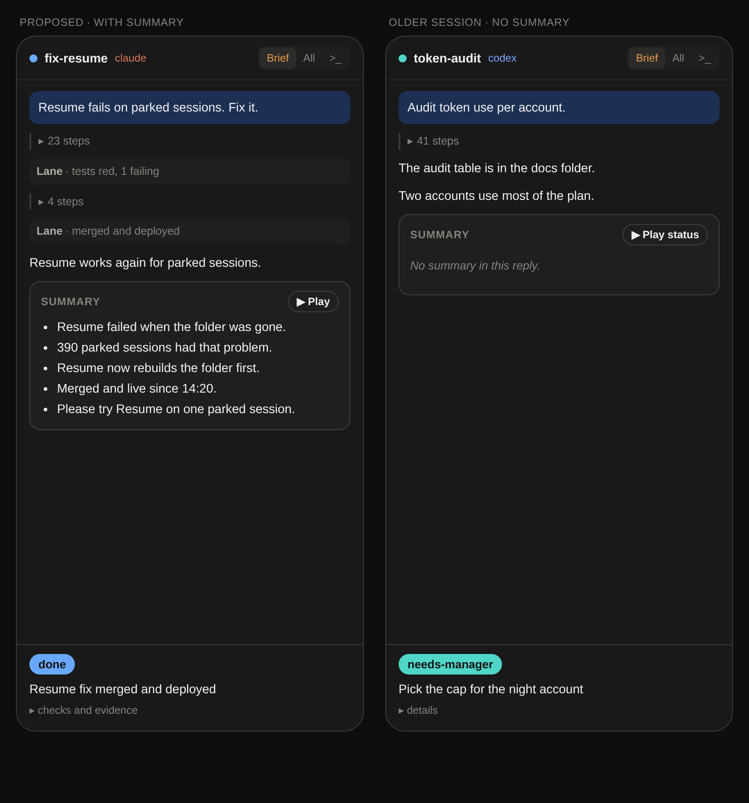

# Reader mode: filtered view, agent summary, audio from the summary (proposal, 2026-11-28)

Status: **step 1 built (2026-11-28)**: the `Summary:` parser, the `summary` / `status` fields of `/api/reply`, the done-check (R) in `dry`, the rule in AGENTS.md and the `cbsession` brief, and a play button that reads the summary only (owner 2026-11-28; REFERENCE "Owner summary before the STATUS"). The Brief / All / `>_` reader view (step 2) is not built. Owner request (2026-11-28): the terminal may show every log line, but the reader
should show only what the owner needs to read. The STATUS line comes last and is the most important thing. Each agent
writes a short summary for a human, 10 lines at most. The play button reads that summary, never the full last response.



Mockup source: [images/reader-summary-mockup.html](images/reader-summary-mockup.html) (passes `mockup-lint.js`);
the 390 px render is [images/reader-summary-mockup-phone.png](images/reader-summary-mockup-phone.png).

## 1. What the reader renders today

| Piece | Where | What it does |
|---|---|---|
| Toggle | `public/app.js` `toggleReader`, `readerOn` | `Aa` / `>_` button per card; the choice is saved in `localStorage['ghosty.reader']` (reader is the default). A Mac session is always the reader. |
| Last reply | `GET /api/reply/<s>` (`server.js` `replyOf`) | The last `⏺` block cut from the tmux pane, 6 000 characters at most. A Mac session uses `remote.lastText`. |
| Whole conversation | `GET /api/transcript/<s>` (`conversation.js` `readConversation`, else `server.js` `transcriptOf` from the pane) | A Claude session reads its own session file: owner prompts as `> `, reply text, `· summary` thinking updates, one `` `Tool arg` `` line per tool call, `` for sent files. Claude sessions and fullscreen sessions load it automatically (`autoFullDue`), so **for Claude the reader shows the whole conversation, not the last reply.** Codex and MiniMax sessions get the pane text. |
| Rendering | `app.js` `renderReply` | Owner prompts in a blue block; prompts typed by the AI side (lane, manager, harness: `prompt-sig.js`) in a gray block labelled `AI · <sender>`, long ones folded; consecutive tool lines folded into `▸ N commands · Bash ×3, Read`; tables, code, pictures. |
| Waiting prompt | `paintReader` | While the session waits for input, the last 24 pane lines are appended as a code block. |
| Copy and audio | `paintReader` → `copyPromptButtonHtml`, `audioChipHtml` (`public/audio-chip.js`) | Both get `audioText = text`, the **same text the reader shows**. |

What the reader does not do: it never singles out the STATUS line, it has no summary, and nothing hides the agent's
working narration, lane notices or verification blocks.

**Audio bug found on the way.** For a Claude session `text` is the whole loaded conversation (`c.full`, up to 40 000
characters on the first load, 200 000 after "older conversation"). `tts.js` refuses anything over `MAX_TEXT = 8000`
characters (`text too long`), so on most Claude cards the play button spins and then fails. On a Codex or MiniMax card
it reads up to 6 000 characters of pane text, about 6 minutes of speech. Both go away with section 5.

## 2. What fills the reader: measured on live sessions

The 25 most recent Claude session files on codebox, run through `readConversation` (newest 60 000 characters each) and
classified per paragraph (script: section 9). Share of reader characters:

| Kind | Share | Real example (shortened) |
|---|---|---|
| Agent prose | 37.7 % | final answers **and** working narration ("Reading the reader-mode code before checking the server side") |
| Tool call lines | 22.4 % | `` `Bash git worktree list \| head -30 && cat …` `` |
| Prompts typed by the AI side (briefs, manager, wakes) | 20.2 % | `> You are picking up work in a fresh session on this host. Working directory: …` |
| Lane and harness notices | 9.9 % | `> <pasted_content …> Integration int-… returned: tests red (exit 1): 1 failing: T03 …` |
| Paragraphs with a STATUS line | 5.8 % | `STATUS: waiting: integration int-1a22192878427cc29` |
| Verification blocks | 2.6 % | `Verification: 1. pass — docs/token-audit-20261128.md has the …` |
| Thinking updates | 1.4 % | `390 of the 658 parked sessions point at deleted folders … · summary` |

So about 60 % of what the reader shows today is not for the owner to read, and much of the remaining prose is narration
written between tool calls.

## 3. Filter list: the new "Brief" view

The reader gets three views in one segmented control in the card header: **Brief** (new, the default), **All** (today's
reader, unchanged) and **`>_`** (terminal). The choice is saved per browser like the current toggle.

| Item | Brief view | Why |
|---|---|---|
| Owner's own prompts (blue) | **keep** | the question the answer belongs to |
| Last turn's final prose (agent text after its last tool call) | **keep** | the answer |
| Pictures and files the agent sent (``, SendUserFile) in the last turn | **keep** | mockups and screenshots are meant for the owner |
| Waiting prompt (the question on screen while the session waits) | **keep** | the owner must answer it |
| Summary block | **keep, as a card** just above the STATUS | section 4 |
| STATUS line | **keep, last, pinned** below the scroll area as a coloured word plus its headline | owner: "most important is status" |
| Tool call lines | hide; one `▸ N steps` line per run, tap to open | 22 % of the text, never read on a phone |
| Thinking updates (`· summary`) | hide inside the same `▸ N steps` | progress chatter |
| Working narration: agent prose followed by more tool calls in the same turn | hide inside `▸ N steps` | the "now I will read X" lines |
| Prompts the AI side typed (lane, manager, done-check, goal-check, wakes, session brief) | fold to one line `Lane · merged and deployed` (sender label + first 60 characters) | the owner did not write them; the line is enough to follow the story |
| `Verification:` block, `closing review:` and `bugs:` fields | fold under the STATUS card: `▸ checks and evidence` | proof for the manager and the harness, not reading for the owner |
| Older turns (before the owner's last prompt) | each shows its owner prompt plus its summary (or its STATUS headline when it has none) | a long session reads as a list of questions and answers |
| Harness notices (`<system-reminder>`, `<task-notification>`, command tags) | already dropped by `conversation.js` `strip` | unchanged |

**What counts as "final prose".** In the turn after the owner's last prompt, the agent text that comes after the last
tool line. If a turn ends with a tool line (still working), Brief shows the newest prose paragraph and `▸ N steps`.
A Codex or MiniMax pane has no tool records: there the pane fallback's tool lines (`transcriptOf`) and the `NOISE_LINE` /
`CHROME_LINE` rules already in `server.js` do the same job.

The STATUS colours reuse the dashboard tokens: done `--done`, running `--working`, waiting `--idle`, needs-manager
`--manager`, needs-owner and failed `--waiting`, blocked `--accent`.

## 4. The summary: format, parsing, how each agent writes it

### Format

```
Summary:
- Resume failed when the folder of a parked session was gone.
- 390 parked sessions had that problem.
- Resume now rebuilds the folder first, then starts the session.
- Merged and live since 14:20 Paris time.
- Please try Resume on one parked session.

Verification:
1. pass — …

STATUS: done — …
```

- A line that is exactly `Summary:` (markdown `**` around it allowed), followed by 1 to 10 lines; each line at most
  160 characters. Bullets (`-`, `•`, `1.`) or plain sentences are both fine.
- Placed in the turn's final message, **after the answer and before `Verification:` and the STATUS line**, so the order on
  screen and in the pane is: answer, summary, checks, status.
- Plain words for a non-technical reader: what happened, what it means for the owner, what the owner must do (if
  anything). No ids, hashes, paths, branch names or commands; those stay in the answer and the STATUS line.
- The block ends at a blank line followed by a non-list line, at `Verification:`, at a `STATUS:` line, or at the end of
  the message.

### Parser: one pure module shared by server and browser

New file `public/reader-summary.js` (pure, no DOM; the server imports it the way it imports `public/prompt-sig.js`):

- `summaryOf(text) -> { lines: string[], tooLong: boolean, lineCount: number } | null`: the **last** `Summary:` block
  in `text`. Pane continuation rows (indented two or more spaces, not a new bullet) are joined to the line above, the
  same rule `lastStatus` uses, so a summary wrapped by a narrow tmux pane still counts as 10 lines, not 25.
  Bullet marks and `⏺` / `•` pane glyphs are stripped. `tooLong` is true above 10 lines or when one line is over 160
  characters.
- `briefOf(text, ai) -> segments[]`: the filter of section 3, as segments `me | steps | ai | prose | media | summary |
  checks | status`, so `renderReply` only draws them. `lastStatus` / `headlineOf` from `status-honesty.js` give the
  STATUS card (moved or re-exported so the browser can import them).

### How each agent provides it

| Agent | Where the rule reaches it | Where the server reads the summary |
|---|---|---|
| Claude Code (codebox) | AGENTS.md / CLAUDE.md of the repo, and the `cbsession` brief | its session file: the last assistant text (`conversation.js`, new `lastReplyText(file)`), falls back to the pane |
| Codex | AGENTS.md (Codex reads it natively), the `cbsession` brief | the pane: `closingLines(plain, 90)` from `stall.js`, the same text the done-check reads |
| MiniMax (`mcode`) | the `cbsession` brief (it is the first prompt) | the pane, as Codex |
| Mac / Remote Control sessions | the repo's AGENTS.md; the Mac Stop hook already sends the stop text | `remote.lastText(s)` |
| The manager | AGENTS.md and its own start brief | the pane, as Codex. It is exempt from the gate below (it talks to the owner in its own session). |

`GET /api/reply/<s>` gains two fields, computed from the same text as the reply:
`summary: string[] | null` and `status: { kind, headline } | null`. The reader asks for them when the reply hash
changes, as today, so there is no new polling.

### The gate: done-check sends back a missing or too long summary

A new check in `done-check.js`, built like the bugs-field check (A): a session whose turn ended with a STATUS of
`done`, `failed`, `blocked`, `needs-manager` or `needs-owner`, and whose closing text has no summary or a summary that is
`tooLong`, gets **one** push per distinct STATUS line, at most 2 a day, only while idle (same `quiet` and
`MAX_NUDGES_PER_TICK` rules). `running` and `waiting` turns are never pushed: the summary is welcome there but not
required, and the reader then shows the STATUS card alone. When the closing-review push (G) also fires, it carries the
summary line too, so a session gets one message, not two. Switch: `manager.json` `summaryCheck: live | dry | off`,
shipped as `dry` for one day (journal only), then `live`.

### Old sessions and a missing summary

- No `Summary:` block: the summary card says "No summary in this reply." in muted text, and there is no play
  button (owner 2026-11-28: "has to be the summary only"; the STATUS headline is not read either). The reader never falls back to reading the whole reply.
- Running sessions are not migrated: they get the rule through the gate's push the next time they end a turn, and new
  sessions get it from AGENTS.md and the `cbsession` brief.
- Considered and rejected: a server-side model call that writes the summary for an old session. It costs tokens on every
  turn of every session (the 2026-11-28 token audit asked for fewer model calls), and a summary written by someone who did
  not do the work can be wrong in a confident way. It can be added later behind a switch if old sessions turn out to matter.

## 5. Audio: read the summary only

Today (`public/app.js` `paintReader`): `audioText = String(text || '').trim()`, where `text` is the shown reply or the
whole loaded conversation; `audioChipHtml({ text: audioText, label: 'Read reply aloud' })`.

Change, all in `paintReader`:

```js
const sum = c?.summary;                       // from /api/reply (section 4)
const st = c?.status;
const spoken = sum?.length ? sum.join('. ').replace(/\.\.+/g, '.')
  : st ? `Status: ${st.kind}. ${st.headline}` : '';
const actions = `<div class="rd-actions">${copyPromptButtonHtml({ text: audioText, label: 'Copy reply' })}${
  spoken ? audioChipHtml({ text: spoken, label: sum?.length ? 'Read summary aloud' : 'Read status aloud' }) : ''}</div>`;
```

- The chip moves into the summary card header (mockup); "Copy reply" stays in the All view.
- `tts.js`, `audio-chip.js` and the `/api/tts` routes do not change: a summary of 10 lines of 160 characters is at most
  1 600 characters, well under `MAX_TEXT`, and the hash cache works as before (same summary, same audio file).
- Voice mode (`voice.js`, `public/voice-view.js`) does not read session replies today and is out of scope.

## 6. Files and tests that change

| File | Change |
|---|---|
| `public/reader-summary.js` (new) | `summaryOf`, `briefOf` (pure) |
| `public/app.js` | `paintReader`: Brief / All / `>_` control, summary card, pinned STATUS card, spoken text; `renderReply` draws `briefOf` segments in Brief; `toggleReader` becomes a three-way choice saved in `localStorage['ghosty.readerView']` (an old `ghosty.reader` value maps to Brief or `>_`) |
| `public/style.css` | `.rd-sum`, `.rd-status`, `.rd-steps`, `.rd-ai-line`, segmented control; the reader's bottom padding for the pinned STATUS |
| `public/icons.js` | no new icon (play, chevrons exist) |
| `status-honesty.js` | `lastStatus` and `headlineOf` moved to `public/status-line.js` (pure) and re-exported here, so the browser can import them |
| `conversation.js` | `lastReplyText(file)`: the last assistant text of the session file (Claude summary source) |
| `server.js` | `/api/reply/<s>` adds `summary` and `status`; reads the session file for a Claude session, else `closingLines` of the pane, else `remote.lastText` |
| `done-check.js` | check (H) "summary missing or too long", message `summaryMessage()`, joined to the closing-review push |
| `manager.json` switch | `summaryCheck` read by `done-check.js` like `doneCheck`; default `dry` for the first day |
| `AGENTS.md` | the rule text below, next to the STATUS table |
| `scripts/cbsession` | one line in the brief, below "End every turn with one STATUS line" (line 206 today) |
| `docs/REFERENCE.md`, `docs/MAP.md`, `docs/USAGE.md`, `docs/RELEASE-NOTES.md` | reader views, summary rule, `/api/reply` fields, the new check; MAP row "Browser views, reader" names `public/reader-summary.js` |

| Test | Change |
|---|---|
| `test/reader-summary.test.js` (new) | `summaryOf`: found / missing / last block wins / 11 lines = tooLong / 161-char line = tooLong / pane-wrapped rows joined / `**Summary:**` / ends at `Verification:` and `STATUS:`. `briefOf`: tool runs become one `steps`, narration between tools hidden, final prose kept, AI prompts become one line, Verification folded, STATUS last; fixtures built from the section 2 examples with fake ids |
| `test/done-check.test.js` | (H) pushes once on a done without summary, never on `waiting` / `running`, once per STATUS line, merged into the (G) push, `dry` writes the journal only |
| `test/conversation.test.js` | `lastReplyText` returns the last assistant text, skips tool results and sidechains |
| `test/status-honesty.test.js` | unchanged; must still pass after the move (re-export) |
| `test/audio-chip.test.js` | unchanged (chip API unchanged) |
| `test/reader-paint.test.js`, `test/phone-reader-wrap.test.js`, `test/reader-measure.test.js` | re-run; Brief adds a pinned element, so the phone wrap check gets one case with the STATUS card at 390 px |
| `test/server-reply.test.js` (new, small) | `/api/reply` returns `summary` and `status` for a pane fixture and for a session-file fixture, on a temp `GHOSTY_STATE_DIR` |
| Headless Playwright (after deploy) | 390 px and desktop: Brief shows prompt, steps line, summary card, STATUS card last; play renders the summary only (POSTed text = summary); All still matches today |

## 7. Exact rule text for agents

**AGENTS.md**, new paragraph right after the "Forms:" paragraph of the STATUS table:

> **Summary before the STATUS (owner 2026-11-28).** The final message of a turn that ends `done`, `failed`, `blocked`,
> `needs-manager` or `needs-owner` carries a summary for the owner, placed after your answer and before `Verification:`
> and the STATUS line: a line `Summary:` and then 1 to 10 short lines (160 characters each at most) in plain words:
> what happened, what it means, what the owner must do, if anything. No ids, hashes, paths, branch names or commands
> in it. The reader shows it above the STATUS and the play button reads only it. A `running` or `waiting` turn may
> carry one. Missing or too long, the done-check sends it back once (link: `docs/READER-SUMMARY.md`).

**`scripts/cbsession` brief**, new line after "End every turn with one STATUS line …":

> Before `Verification:` and the STATUS line, write `Summary:` and 1 to 10 short plain-language lines for the owner
> (what happened, what it means, what they must do); no ids, paths or commands. The reader and the play button show
> only that summary.

**Done-check message** (`summaryMessage()`):

> Done check: your last message has no `Summary:` block, or it is longer than 10 lines (or a line is over 160
> characters). The owner reads only the summary and the STATUS on the phone, and the play button reads only the
> summary. Add `Summary:` with 1 to 10 short plain-language lines (what happened, what it means, what the owner must
> do; no ids, paths or commands) just before `Verification:`, then repeat the STATUS line unchanged.

## 8. Rollout

1. PR 1 (server + gate, no UI change): `public/reader-summary.js`, `public/status-line.js`, `/api/reply` fields,
   `conversation.js` `lastReplyText`, done-check (H) in `dry`, AGENTS.md and `cbsession` rule text, tests. Deploy
   `server`. New sessions start writing summaries; the journal shows how many turns would be pushed.
2. PR 2 (reader): Brief / All / `>_`, summary card, pinned STATUS, audio from the summary. Deploy `frontend`; headless
   check at 390 px and desktop on the deployed URL.
3. After one day of `dry` with a push rate under 1 in 5 closing turns: `summaryCheck: live`.
4. Running sessions need no migration: the rule reaches them through the push on their next closing turn; old turns show
   "No summary in this reply." and read the STATUS aloud.

## 9. How the numbers in section 2 were made

A throwaway script imported `readConversation` from `conversation.js` and `TOOL_LINE` from `public/tool-lines.js`, read
the newest 60 000 characters of each of the 25 most recently changed session files under the account `projects/`
folders, split on blank lines and counted characters per kind with the regexes of section 3 (AI prompts by their
`> ` prefix; lane and harness prompts by their opening words: `Done check`, `Goal check`, `Integration int-`,
`<pasted_content`, `Read …/inputs/`). It was run once on 2026-11-28 and is not kept in the repo.
