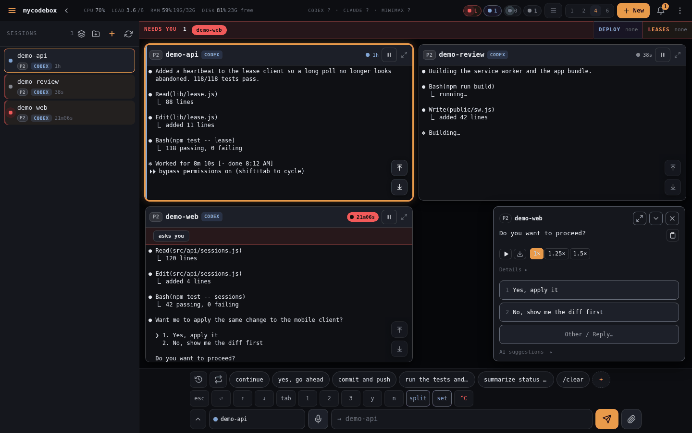
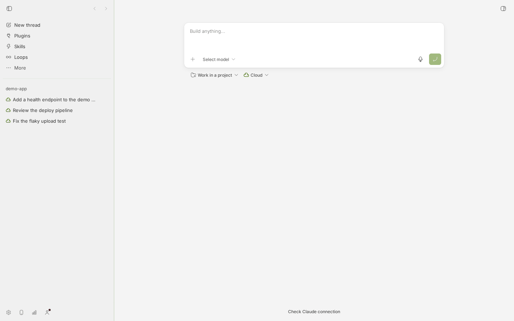
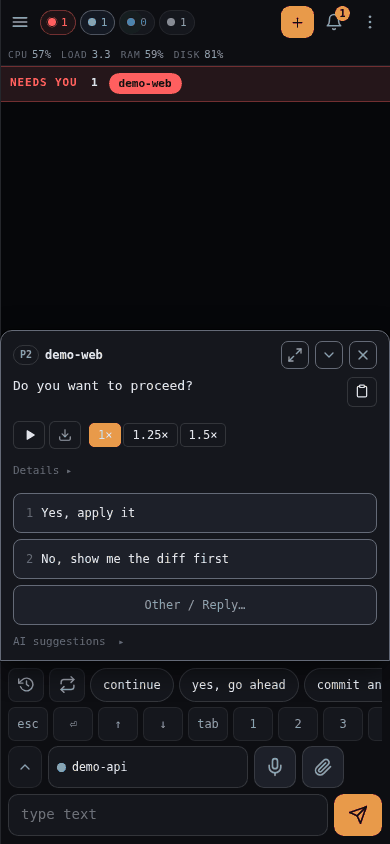
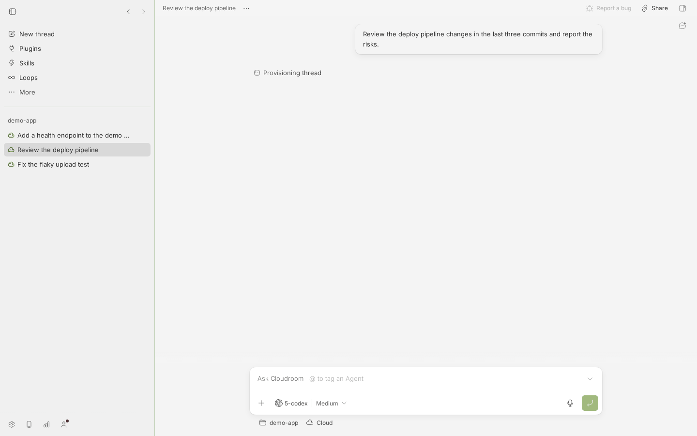
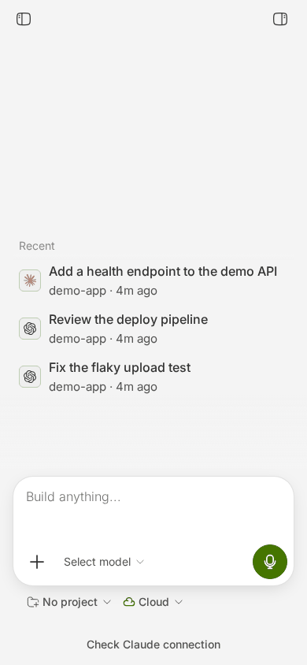
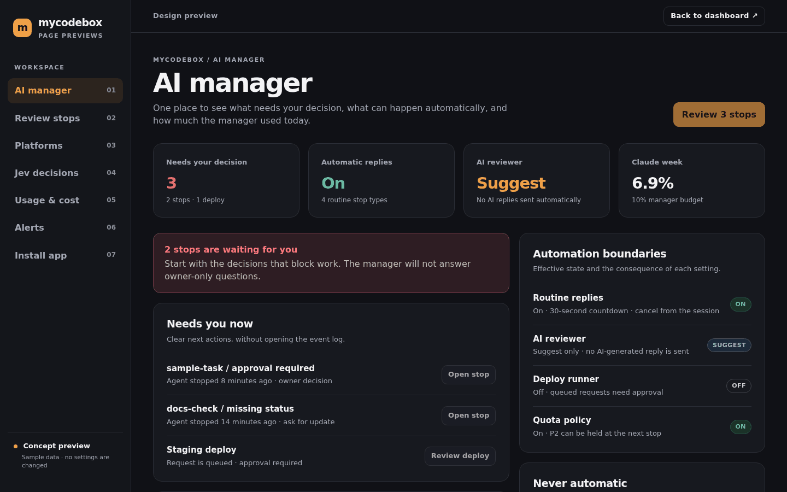
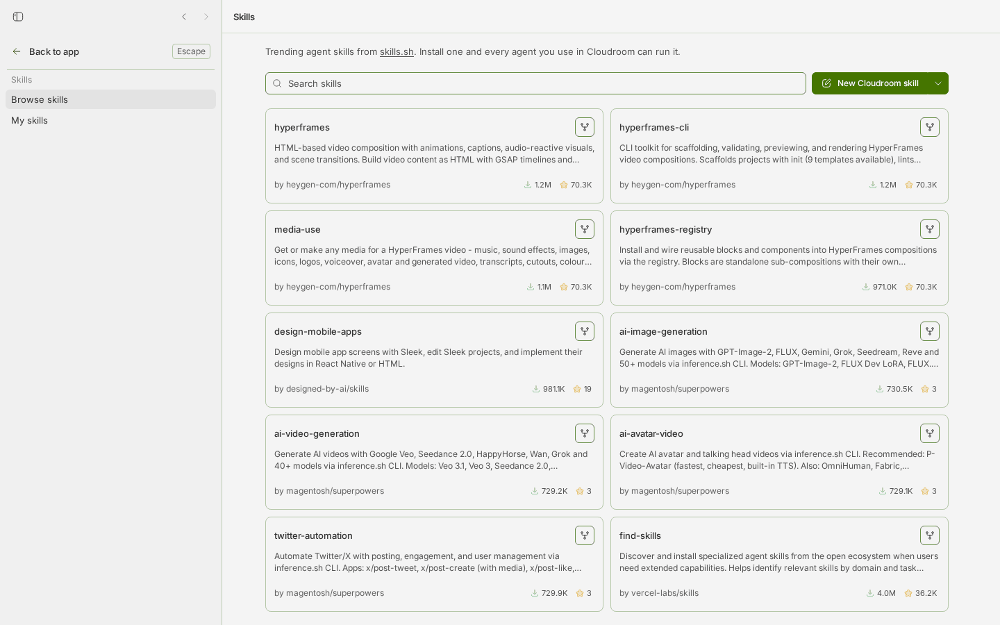

# mycodebox vs Cloudroom

Owner request (2026-10-23): "review couldroom, an open source tool that does like our mycodebox. Compare both
apps and see what we can learn and do to improve our UI/UX and functionality. Take screenshots, compare the
UI, compare the functionality, show what is good and bad."

Everything below was produced by running both products on this host. No production mycodebox card, no real
session, no real credential and no shared platform was touched. Screenshots show demo data only.

## 1. Which tool is "couldroom"?

**Cloudroom**, and the name is a phonetic match, not a guess:

| Repo | Stars | Stack | License |
|---|---|---|---|
| [davidondrej/cloudroom-core](https://github.com/davidondrej/cloudroom-core) | 984 | Rust | Apache-2.0 |
| [davidondrej/cloudroom-gui](https://github.com/davidondrej/cloudroom-gui) | 140 | TypeScript (Electron + Vite/React) | Apache-2.0 |

The upstream description is "Open-source, self-hostable Rust runtime that runs Claude Code, Codex, and Pi in
the cloud"; the GUI is "an ADE that lets you run 1,000+ agents productively" (ADE = agentic development
environment). Its README says the product "runs Claude Code, Codex, and Pi on your Mac or in the cloud" and
that you can "reach it from your laptop" - i.e. exactly "an open-source tool that manages remote AI coding
sessions from a browser or phone".

Two repos, one product:

- **cloudroom-core** (Rust) is the agent runtime: one service per machine, runs the harnesses, stores chat
  history, exposes a token-authenticated HTTP API. It is API-only - there is no web UI in the core.
- **cloudroom-gui** is the app you actually look at: an Electron desktop app whose React/Vite front end
  (`gui/apps/app`) talks to a local Node server (`gui/apps/server`), a `host-daemon` for the local machine and
  optional cloud sandboxes.

Alternatives considered, and why they are not "couldroom" (not run, listed for the record):

| Alternative | Stars | What it is | Why it is not the match |
|---|---|---|---|
| [siteboon/claudecodeui](https://github.com/siteboon/claudecodeui) (CloudCLI) | 14.3k | Web UI + mobile app for Claude Code / Codex, self-hosted or hosted, Docker sandboxes | Right category, wrong name; no product called "couldroom" |
| [slopus/happy](https://github.com/slopus/happy) | 24.3k | End-to-end encrypted mobile app (iOS/Android/web) + relay | Mobile-first companion for your own CLI, not a multi-machine agent runtime |
| [BloopAI/vibe-kanban](https://github.com/BloopAI/vibe-kanban) | 28.4k | Kanban board that drives coding agents per task | A task board, not a session dashboard with a phone UI |

Cloudroom was compared in depth because the name and the function both match; the three alternatives above are
different products in the same category.

## 2. How both were run (safe method)

**mycodebox** - second instance from a git worktree of this repo, own state dir, own port, demo tmux sessions
only:

```bash
HOME=<scratch> HOST=127.0.0.1 PORT=7999 GHOSTY_STATE_DIR=<scratch>/mcb-state \
  TMUX_BIN=<scratch>/tmux-demo node server.js
```

`tmux-demo` wraps `tmux` and filters `list-sessions` / `list-panes` to `demo-*` sessions only, and refuses to
act on any other target, so the real sessions on this host were invisible to the demo and untouched. The demo
sessions are three fake agent panes (`done`, `needs you`, `working`) painted by a throwaway script. `ssh` was
stubbed so the lease panel answered with an empty list instead of reaching the shared platform.

**Cloudroom** - the GUI workspace cloned to `<scratch>`, `pnpm install`, then:

- `@cloudroom/server` on `127.0.0.1:7881`, `@cloudroom/app` (Vite dev) on `127.0.0.1:7882`, `@cloudroom/host-daemon`
  on `127.0.0.1:7883`, all bound to loopback and never exposed on the tailnet.
- `HOME` pointed at a scratch directory for the daemon, so no real agent CLI, credential or account was reachable.
- No Cloudroom account was created. The app was put in its documented **self-hosted core** mode by writing a
  `cloudroom.json` connection (URL + token) into the demo data dir.
- The upstream release binary of `cloudroom-core` was tried first and **could not run here**: it needs
  `GLIBC_2.39`, this host is Debian 12 with glibc 2.36. A small local stub answered the handful of `/v1`
  endpoints the app probes (`health`, `ready`, `capabilities`, `dashboard`, `sessions`, command receipts), so the
  real app UI could be exercised end to end. Consequence, stated plainly: **the screenshots show Cloudroom's real
  UI and real data model, but not a live agent conversation** - the agent side was a stub by design.

Screenshots were taken with Playwright (Chromium), desktop 1440x900 and mobile 390x844 with an iPhone user
agent, and are in [`images/`](images/).

## 3. UI/UX, side by side

### 3.1 Session board vs compose screen

| mycodebox | Cloudroom |
|---|---|
|  |  |

**What Cloudroom does better**

- The thread list is *structured*: project -> thread, with the provider icon on every row. mycodebox's left rail
  is a flat list of tmux session names, which is only meaningful to someone who knows what a tmux session is.
- The empty space is intentional. One composer in the middle, nothing else. For a first run this is calmer than
  a grid of cards.
- The right-hand panel is a first-class concept (a togglable pane), not a modal.

**What mycodebox does better**

- The board shows *state at a glance*: a red "needs you" banner, a per-card state dot, the last activity, a
  pause button, a kill button, an expand arrow - on one screen, without opening anything.
- Every session is visible at once. Cloudroom shows one conversation and a list; you compare by opening.
- The header is an operator strip (CPU / load / RAM / disk, quota per agent, session counts, board layout
  switch, `+ New`): the state of the machine, not just the chat.

### 3.2 A thread with a question to answer

| mycodebox | Cloudroom |
|---|---|
|  |  |

**What Cloudroom does better**

- The composer is a real IDE-style prompt box: `+` attachments, model *and* reasoning level, voice input,
  environment selector (`Cloud` vs local), project selector, `@` to tag an agent. mycodebox's input is a plain
  text field with a mic and a paperclip.
- Thread-level chrome is clear: title, "Report a bug", "Share", side panel toggle.
- The message is rendered as a clean bubble, not as a pane dump.

**What mycodebox does better**

- mycodebox answers the actual problem. The agent asked "Do you want to proceed?" and the panel extracted the
  two options from the pane and offered them as one-tap buttons, plus a free-form reply, plus AI suggestions,
  plus a row of quick keys. Cloudroom's composer can only send text; the owner has to read and transcribe the
  options.
- mycodebox shows the raw agent screen *and* the parsed answer side by side, so nothing is hidden behind a
  rendering choice. On a phone, zoom (1x / 1.25x / 1.5x) and swipe-to-scroll inside a card make a terminal
  screen usable.

### 3.3 Mobile

| mycodebox | Cloudroom |
|---|---|
|  |  |

- Cloudroom's mobile layout is a clean "Recent" list plus a composer - readable, but it is a *different* product
  on the phone: no session state, no answers, no quick keys.
- mycodebox's phone UI is the whole product: live panes, one-tap answers, quick keys, voice, attach, zoom.
- Cloudroom does ship the better *install* story: it asks for "Add to Home Screen" with numbered instructions
  and explains the iOS caveat; mycodebox has a PWA and an Android APK but the install guidance is thinner.

### 3.4 The operations layer

| mycodebox | Cloudroom |
|---|---|
|  |  |

- mycodebox has an operations console: AI manager (what it decided, what it did, what it did *not* do), review
  stops, leases, deploys, quota policy, usage and cost, alerts, install app. Cloudroom has **none of this**.
- Cloudroom has an ecosystem surface mycodebox does not have at all: 31 bundled plugins (providers, environments,
  automations, computer use, push notifications, secrets, workflows), a live skills registry (skills.sh) with
  one-click install, and "Loops" for recurring agent work.

## 4. Functionality matrix

Legend: **yes** = present and usable, **part** = partial, **no** = absent.

| Capability | mycodebox | Cloudroom |
|---|---|---|
| Multi-agent / multi-provider | Claude, Codex, MiniMax, OpenCode via tmux; agents are whatever CLI is installed | Claude Code, Codex, Pi, Cursor, OpenCode, Hermes, Devin, OpenClaw, fx - as *plugins* with per-provider model catalogues |
| Local + remote execution | Local host only (tmux), reached over the tailnet | Local machine (host-daemon) **and** cloud sandboxes, one sandbox per thread, own git branch |
| Mobile / PWA | Yes: web app, PWA, Android APK, install sheet | Yes: PWA with an install prompt, phone web UI (no first-party mobile app in the open-source repos) |
| Push notifications | Web Push (ntfy), per session, tested from the UI | Push-notifications plugin; web push in the PWA |
| Approvals / interactions | "asks you" panel: question parsed, one-tap options, AI suggestions | Interactive requests handled per provider; the core runs agents **without approval prompts** |
| Files / upload | Image upload to the session; attachments in the composer | Attachments (images + files), upload parts, file tree |
| Terminal | No separate terminal; the agent's own pane is shown | In-app terminal per thread, xterm-based |
| Git / diff | Repo, branch, dirty state per session | Worktrees, branch per thread, diff viewer (`@pierre/diffs`) |
| Cost / usage | Usage and cost view (Langfuse), quota chips, per-agent rate windows | Provider usage plugin, `usage` capability per harness |
| Permissions | CLI-level (`--dangerously-skip-permissions` by default), network gate only | Mac access levels Off / Read-only / Ask first / Full; per-host max permission mode; Command Guard on the core |
| Extensibility | None (one repo, one runtime dependency) | 31 plugins, plugin SDK, marketplace, skills registry, Loops, workflows |
| Theming | Dark UI, one style | Light theme by default, dark option, plugin-level styling |
| Install effort | `git clone`, `npm ci`, `node server.js`. One dependency (`ws`), no build step | pnpm 9.15.9 + turbo monorepo, Electron, plugin SDK build, Rust core (or a prebuilt binary needing glibc 2.39) |
| Security model | No login; Tailscale policy is the gate; origin checks; reporter tokens | Token per core, loopback by default, agents as a separate Linux user, Command Guard, per-machine permission mode |
| Offline | Works fully offline on the tailnet | Local mode works; cloud features need the Cloudroom service |
| Ops layer (leases, deploys, review queue, manager journal) | **Yes** - this is the core of mycodebox | No |
| Teleport a running session between machines | No | Yes (Mac -> cloud -> Mac, same chat/model/effort) |

## 5. Verdict

### 5.1 Top 10 things mycodebox should adopt (ranked by value / effort)

Each line is ready to become a task. Not started, by request.

1. **Machine access levels for the agent** (`Off` / `Read-only` / `Ask first` / `Full`) - value H, effort M.
   mycodebox launches agents with `--dangerously-skip-permissions` as the same Unix user as the service, so a
   runaway agent has the full host. Cloudroom makes this a per-machine choice. This is the single most
   valuable thing in the other product.
2. **A runtime command guard** - value H, effort M. Cloudroom's core blocks a handful of destructive commands
   before they run. mycodebox has no equivalent: a mis-typed `rm -rf` in a session is one keystroke away.
3. **Disk-space safety policy** - value H, effort S. Cloudroom's core blocks new work when the workspace or
   history volume falls below a threshold, with a reason code. mycodebox only *reports* low disk.
4. **Share a thread read-only by link** - value M-H, effort S-M. Cloudroom has a Share button per thread;
   mycodebox has none. A link to a finished turn is exactly what an owner sends to a colleague.
5. **Model + reasoning-level picker per provider** - value M-H, effort M. Cloudroom shows the models of the
   chosen provider and the reasoning levels it supports; mycodebox drives a CLI that has its own flags, so
   model choice is invisible in the UI.
6. **One-click install of agent skills from a registry** - value M-H, effort M. Cloudroom's Skills page is a
   browsable registry (skills.sh) with an install button; mycodebox has no skill concept at all.
7. **A desktop shell for the Mac** - value M-H, effort S-M. Cloudroom is an Electron app; mycodebox is
   web-first and works well, but there is no "mycodebox.app" with a tray icon and a global shortcut. A thin
   wrapper around the existing PWA is cheap.
8. **Per-thread branch and workspace isolation** - value M, effort M. Cloudroom gives each thread its own
   sandbox and branch; mycodebox sessions share the working tree of whoever started them.
9. **An in-app terminal per thread** - value M, effort M. mycodebox shows the agent's pane, not a terminal you
   can type into yourself. `tmux` makes this easy; the dashboard just does not expose it.
10. **@-mention another agent inside a thread** - value M, effort M-H. Cloudroom can tag a second agent in a
    prompt (`@ to tag an Agent`); mycodebox has no notion of a sub-agent handoff inside one session.

(Deliberately *not* on the list: the plugin marketplace - too large for the value today; a Rust core - mycodebox's
single-dependency, no-build-step property is worth more; cloud sandboxes - the tailnet single-host model is the
product.)

### 5.2 Top 5 things mycodebox does better (keep)

1. **The operations layer**: leases, deploy queue, platforms, AI manager with a decision journal, review stops,
   quota policy, usage and cost. Cloudroom is a conversation app; mycodebox is a control room. That is the
   product's actual job and it is not duplicated anywhere in the other tool.
2. **Install effort**: one runtime dependency, no build step, no Electron, no Rust, no monorepo. `git clone &&
   npm ci && node server.js` still stands, and that is a real advantage on a small VPS.
3. **Phone-first depth**: the grid, the swipe-scroll inside a card, the zoom levels, the quick-key row and the
   parsed one-tap answers. On a phone Cloudroom is a nicer list; mycodebox is a usable console.
4. **The question-answering loop**: extracting the agent's question and its options from the pane and turning
   them into buttons is the feature the owner uses most, and there is no equivalent in Cloudroom.
5. **No account, no login, no vendor**: Tailscale policy is the only gate, nothing to sign into, telemetry off
   by default, history on your own disk.

### 5.3 Top 5 risks seen in the other tool

1. **Agents run without approval prompts.** The core README says it plainly: "Agents run without approval
   prompts, so give each trusted user their own machine." On a shared host that is a standing exposure;
   mycodebox at least surfaces "needs you" and waits for a human.
2. **The host daemon is a large blast radius.** The daemon exposes the machine to the app with a permission mode
   that can be `full`. A mistake in one agent session becomes a mistake on the whole machine.
3. **The open-source story is thinner than it looks.** The core is API-only, so self-hosting the core gives you
   no web UI; the UI is the desktop app, which is macOS-only (Linux is an alpha), and the cloud path needs a
   Cloudroom account (invite-only). The parts that are genuinely open (core, plugins) are not the parts an
   operator mostly uses.
4. **Install weight and pre-release maturity.** pnpm + turbo + Electron + a plugin SDK that has to be built
   before the provider plugins load, 31 plugins to keep working, and a pre-release core whose release binary
   needs glibc 2.39 (it did not run on this Debian 12 host without a source build). mycodebox's `npm ci` is a
   different order of magnitude.
5. **Capability-flag fragmentation.** Every optional feature is gated by a per-core-version flag, and "missing"
   means unsupported. A client that does not check the flags shows a dead button instead of an explanation - we
   hit exactly that while testing (a model picker that could not load, a core that answered "not available").
   The rule "a missing flag means unsupported, never enabled" has to be respected everywhere, or the UI lies.

## 6. Reproducing this comparison

```bash
# mycodebox demo instance (own state dir, own port, demo sessions only)
HOME=<scratch> HOST=127.0.0.1 PORT=7999 GHOSTY_STATE_DIR=<scratch>/mcb-state \
  TMUX_BIN=<scratch>/tmux-demo node server.js

# Cloudroom GUI (loopback only, no account, scratch HOME)
pnpm install                      # gui/ of davidondrej/cloudroom-gui
pnpm --filter @cloudroom/server dev    # 7881
pnpm --filter @cloudroom/app dev       # 7882
pnpm --filter @cloudroom/host-daemon dev # 7883
```

The demo tmux wrapper, the fake agent panes and the stub core are throwaway test aids and deliberately live
outside this repository; the screenshots in `images/` are the evidence.
